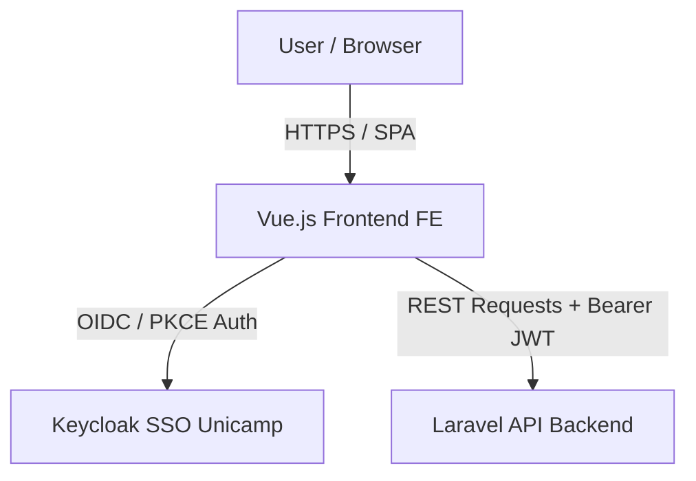

# System Architecture - C4 Model (Frontend)

## 1. Context Level
Single Page Application (SPA) interface developed in Vue.js / Vuetify for the School of Education (FE/Unicamp), integrated with Keycloak SSO identity server and consuming the Laravel RESTful API.

## 2. Container Level
- **Vue.js SPA (`src/`):** Single Page Application containing route management (Vue Router), state management (Vuex), UI library (Vuetify), and HTTP client (Axios).
- **Keycloak SSO:** Centralized OIDC authentication provider with silent token refresh (`silent-check-sso.html`).
- **Laravel API Backend:** RESTful service providing business logic and data for FE/Unicamp.