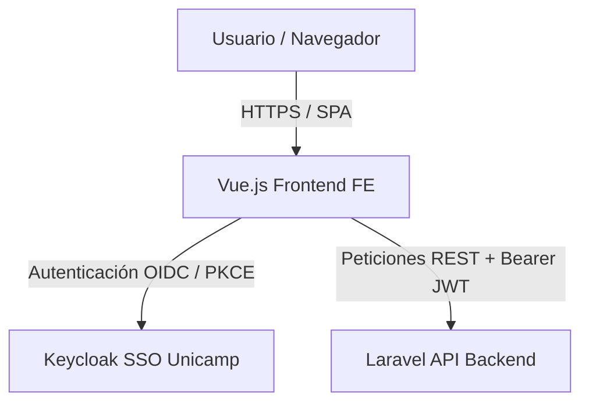

# Arquitectura del Sistema - Modelo C4 (Frontend)

## 1. Nivel de Contexto
Interfaz Single Page Application (SPA) desarrollada en Vue.js / Vuetify para la Facultad de Educación (FE/Unicamp), integrada con el servidor de identidad Keycloak SSO y consumiendo la API RESTful de Laravel.

## 2. Nivel de Contenedores
- **Vue.js SPA (`src/`):** Aplicación Single Page que contiene control de rutas (Vue Router), gestión de estado (Vuex), biblioteca de UI (Vuetify) y cliente HTTP (Axios).
- **Keycloak SSO:** Proveedor de autenticación OIDC centralizado con renovación silenciosa de tokens (`silent-check-sso.html`).
- **Laravel API Backend:** Servicio RESTful proveedor de datos y reglas de negocio para FE/Unicamp.