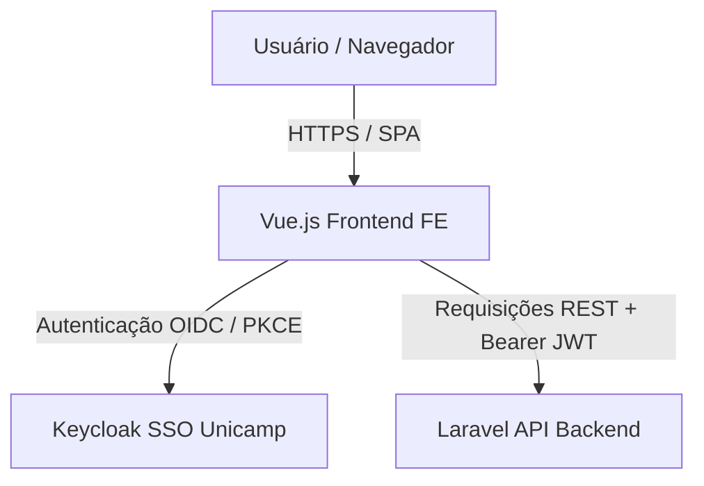

# Arquitetura do Sistema Frontend - Modelo C4

## 1. Nível de Contexto
Interface SPA (Single Page Application) desenvolvida em Vue.js / Vuetify para a Faculdade de Educação (FE/Unicamp), integrada ao servidor de identidade Keycloak SSO e consumindo a API RESTful em Laravel.

## 2. Nível de Contêineres
- **Vue.js SPA (`src/`):** Aplicação Single Page contendo controle de rotas (Vue Router), gerenciamento de estado (Vuex), biblioteca UI (Vuetify) e cliente HTTP (Axios).
- **Keycloak SSO:** Autenticação centralizada OIDC com renovação silenciosa de token (`silent-check-sso.html`).
- **Laravel API Backend:** Serviço RESTful fornecedor dos dados e regras de negócio da FE/Unicamp.